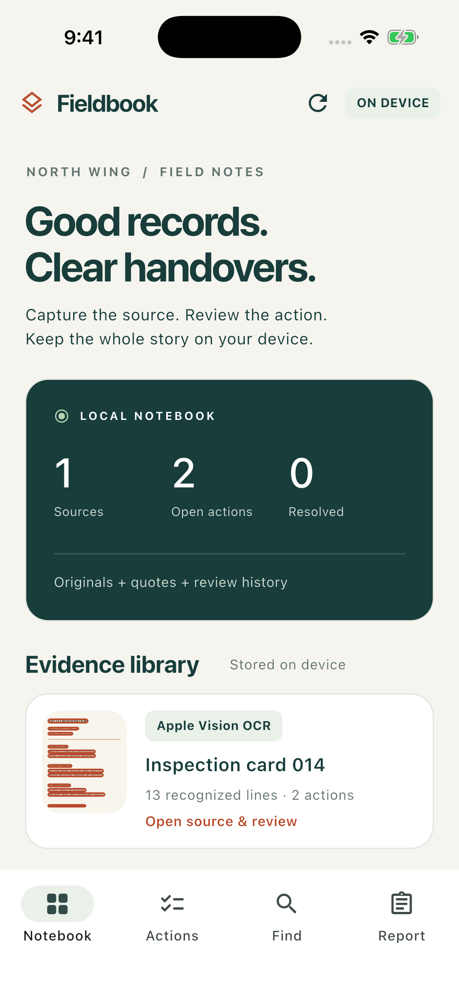
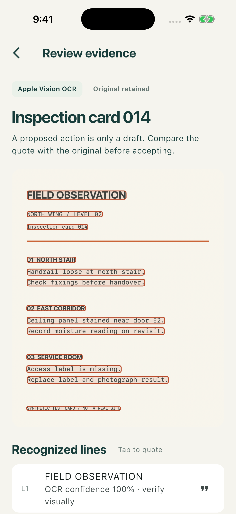
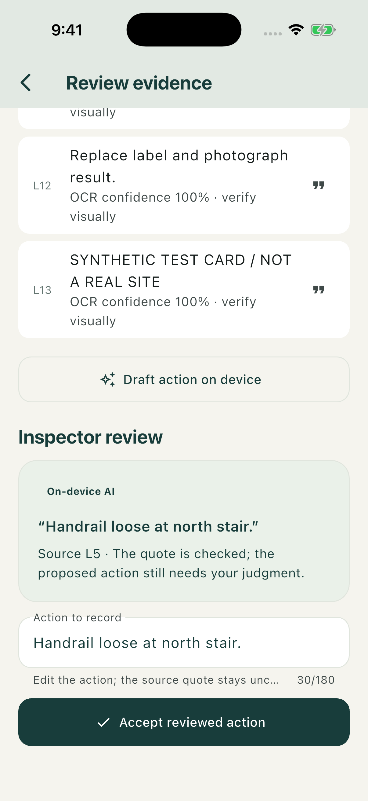
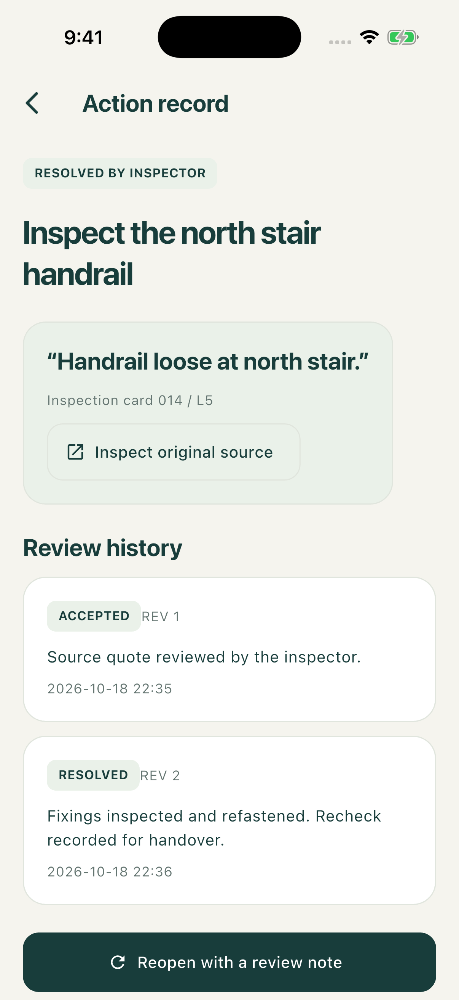
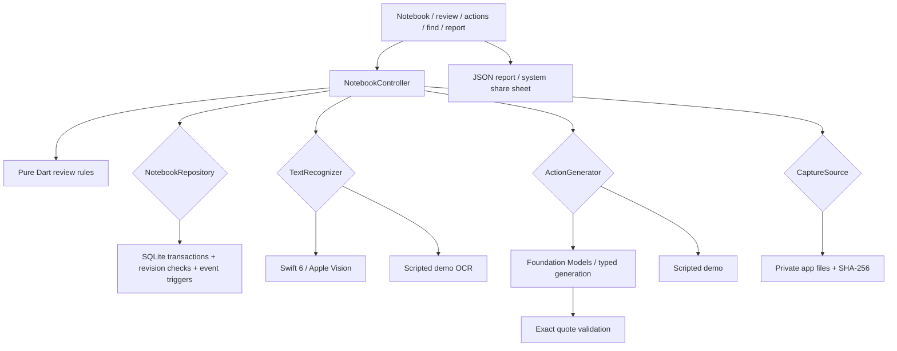

# Fieldbook

An offline inspection notebook that turns source images into reviewed, traceable actions.

[](https://github.com/OwaisMunawar/fieldbook/actions/workflows/ci.yml)


[](LICENSE)

<p>
  
  
  
  
</p>

Unedited `simctl` captures from an iPhone 17 Pro **simulator**, iOS 26.5. The inspection card and repair notes are synthetic test data. Vision recognition and the Foundation Models draft ran on the simulator; the action log also contains manually reviewed, extractive actions. These are not physical-device or real-site results. [All captures and provenance](docs/VERIFICATION.md).

## Why

A follow-up like “check the stair handrail” becomes difficult to trust when nobody can find the note it came from. A model can make the sentence sound better while making its origin harder to check.

Fieldbook keeps the image, recognized lines, proposed action and inspector review together. An action cannot be accepted unless its quote belongs to the stated OCR line. That checks the citation, **not the correctness of the proposed action**: the inspector still compares it against the original. Resolving or reopening an action requires a note and creates a new revision.

## Features

- **Real on-device OCR.** A Swift 6 platform channel runs Apple Vision off the main actor, returns confidence and normalized text regions, and handles image orientation. Choose a photo, use the camera, or scan the bundled synthetic card.
- **An optional local language model.** On supported iOS 26 environments, Foundation Models returns a typed action and source index. The native adapter binds the original OCR quote and ID; Dart checks them again before review. No API key, account or bundled model download.
- **Honest fallbacks.** Without an available language model, the app labels a source-line draft “Extractive fallback.” A separate deterministic demo configuration labels both OCR and generation as scripted, uses a separate database, and refuses personal-photo imports.
- **Inspector control.** Tap any OCR line to quote it, edit the proposed action, then accept explicitly. Low-confidence source lines are blocked below 0.45; that threshold is a product rule, not an accuracy guarantee.
- **Durable review records.** SQLite transactions commit issue changes and events together. Revision checks reject stale edits, fingerprints deduplicate identical image bytes, a unique source-quote constraint prevents duplicate actions, and database triggers reject event updates or deletions.
- **Source retrieval.** Local word-overlap search returns original snippets with line IDs and image links. It abstains when nothing matches; it does not generate answers.
- **Portable reports.** Export versioned JSON with OCR text, regions, image SHA-256 digests, action origins and review history. Original images and local filesystem paths are excluded. A digest identifies bytes; it does not authenticate them.
- **Accessible screens.** Semantic controls, error announcements, flexible layouts and widget checks at double text size. No runtime font fetches or document-upload service.

## Architecture



Feature code lives in `lib/features/notebook/{domain,application,data,presentation}`. Riverpod owns composition and lifecycle; domain code has no Flutter or platform dependencies. The architecture check rejects forbidden layer imports. [Decisions, rejected alternatives and transaction boundaries](docs/ARCHITECTURE.md).

## Tech stack

| Concern | Choice |
| --- | --- |
| UI | Flutter 3.44.2 / Dart 3.12.2, Material 3, shared design tokens |
| Composition | Riverpod 3.4.3, injected repository / recognizer / generator / capture ports |
| Local persistence | sqflite 2.4.4+2; real SQLite through FFI in storage tests |
| Recognition | Apple Vision, accurate English OCR, top-left normalized regions |
| Generative drafts | Apple Foundation Models, guided Swift structures, explicit availability check |
| Media | image_picker, path_provider, SHA-256 through crypto |
| Export | Versioned JSON, share_plus, explicit iPad popover anchor |
| Verification | flutter_test, integration_test, 0.5% tolerant macOS goldens, actionlint |

## Quick start

Requires Flutter 3.44.2, Xcode 26 or newer, CocoaPods and an installed iOS simulator runtime. The app targets **iOS only** in this release. iOS 18 supports OCR and extractive review; Foundation Models needs iOS 26 and an available Apple Intelligence model.

```sh
git clone https://github.com/OwaisMunawar/fieldbook.git && cd fieldbook
flutter pub get
flutter run
```

Tap **Scan sample card**, tap a recognized line or **Draft action on device**, review the quote, edit the action and accept. Open **Actions** to resolve it with a note; **Find** links matching words back to the source; **Report** exports JSON through the system share sheet.

For a deterministic, keyless demo, use `flutter run --dart-define=FIELDBOOK_DEMO=true`. Standard mode is also keyless and uses real Vision OCR. Demo and standard data are stored separately. CocoaPods may need `LANG=en_US.UTF-8 LC_ALL=en_US.UTF-8` in your shell.

## Quality

```sh
flutter analyze --fatal-infos
dart run tool/check_architecture.dart
flutter test --coverage --exclude-tags golden
dart run tool/coverage_gate.dart
flutter test --tags golden
flutter test integration_test/notebook_test.dart -d <your-simulator-id>
```

- **25 unit, storage, bridge-contract and widget tests**, plus **3 golden tests**. Domain and application line coverage measured **99.6% (228/229)**; CI fails below 90%.
- Storage tests exercise real SQLite, competing review writes, stale revisions, close/reopen persistence, duplicate imports and append-only event triggers.
- Bridge tests cover malformed OCR, invented quotes, missing platform support, model unavailability and timeouts. Mock bridge tests are distinct from the real simulator run.
- The native integration workflow ran successfully on iOS 26.5 with real OCR and an available Foundation Models model, then exercised review, resolution, retrieval, report construction and a separate database connection.
- CI checks formatting, strict analysis, layer boundaries, coverage, macOS goldens and an unsigned Swift 6 iOS simulator build. The simulator integration test is run locally, not in CI. [Verification scope](docs/VERIFICATION.md).
- `.maestro/inspection.yaml` is provided but **unrun**; Maestro is not installed in the verification environment.

## Known gaps

- No physical-device, camera, real-site, iOS 18, or production deployment validation. Simulator sample OCR is not a camera-quality benchmark.
- English OCR only. Model output is not semantically proven by an exact quote; prompt injection and misleading source text still require inspector judgment.
- One notebook with a fixed “North Wing” label. No project editor, cloud sync, collaboration, notifications or account system.
- SQLite and images have no additional application-layer encryption or biometric lock. OS backups may include them. Local database triggers are not a tamper-proof audit ledger.
- JSON export contains text and notes, not original images; it is a report, not a restorable backup. No PDF export or report import.
- Evidence and history are read into memory; there is no pagination, retention policy or history compaction yet. Images are limited to 20 MB; imports are normalized by the picker.
- Native model generation can be unavailable or time out. No device performance, OCR accuracy or energy-use claims are made.

## Roadmap

- Editable projects, multiple notebooks and batch capture.
- A cross-platform recognition adapter and Android validation.
- Encrypted local storage, explicit retention and a reviewed backup/restore format.
- Linked follow-up photos, PDF handover packs and broader OCR-language coverage.
- Physical-device accessibility, camera and adverse-light testing.

Built by [Owais Munawwar](https://github.com/OwaisMunawar). I'm available for React Native, AI and iOS work on [Upwork](https://www.upwork.com/freelancers/owaism11).
